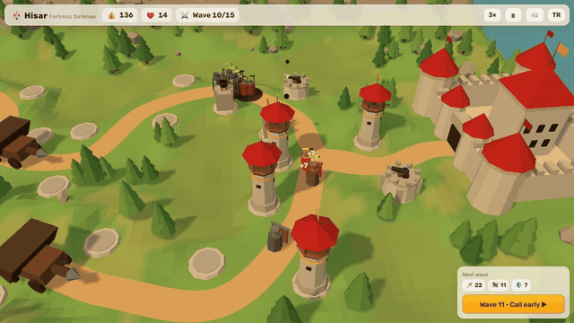
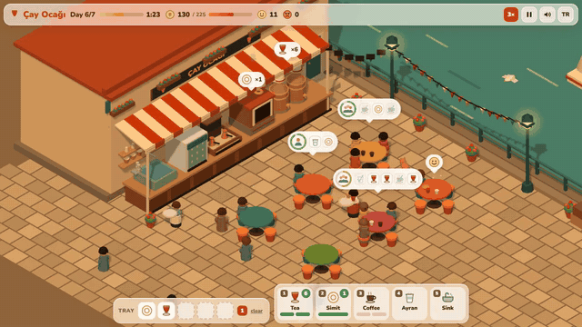
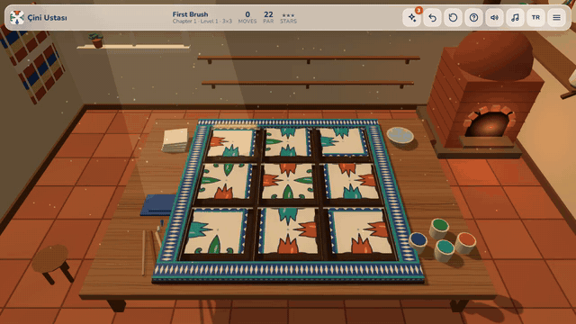
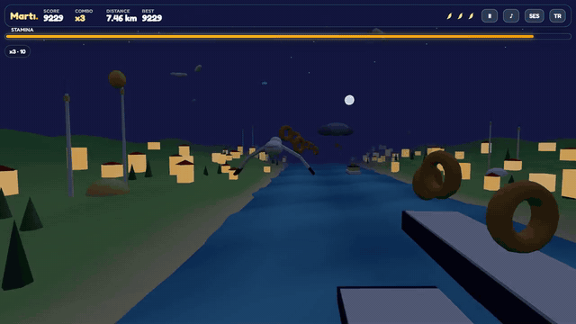
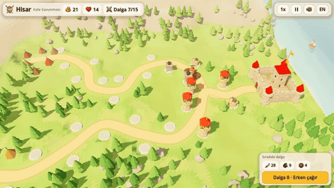
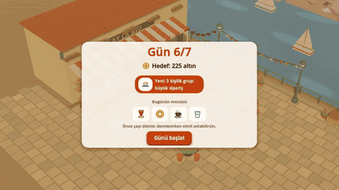
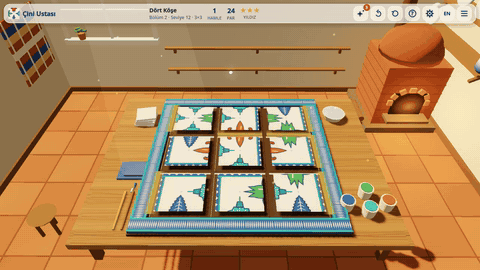
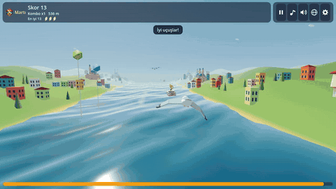

# 🏟️ Claude Game Arena

**[▶ Open the arena page](https://furkiozknn.github.io/claude-game-arena/)** · eight free browser games · four AI models · two rounds

Can an AI model build a whole game on its own, and which model builds the best one? Each game here was made by a
**different Claude model** from a single prompt: same prompt structure, same quality bar, same self-test rule, no peeking
at the other games' code. In **round 1** every game is one `index.html` with Three.js; in **round 2** each model remade its own game in
**Godot 4**. All eight are playable in the browser on desktop and mobile, in Turkish and English.

> **Remaster (2026-10-21):** after both rounds were scored, the orchestrating session (Claude Opus 5.5) remastered all
> eight games: generated 3D models, textures and icons (Higgsfield: Tripo text-to-3D, GPT Image; processed with
> glTF-Transform), a shared [design language](docs/design-language.md) (settings, pause menu, saves, keys, touch
> targets), and every bug found in an independent review. The scorecards below describe the games as each model
> delivered them; the playable builds are the remastered versions. The browser games keep their procedural models as
> a fallback when opened from `file://`. Details: [Remaster](#remaster-2026-10-21).

## Round 1: browser games (Three.js)

| | Game | Genre | Built by | Play | Code |
|---|---|---|---|---|---|
|  | **🏰 Hisar** · Fortress Defense | Tower defense | Claude Opus 5.5 | [Play](https://furkiozknn.github.io/kale-savunmasi/) | [Repo](https://github.com/Furkiozknn/kale-savunmasi) |
|  | **🍵 Çay Ocağı** · Tea House Rush | Time management | Claude Sonnet 5.5 | [Play](https://furkiozknn.github.io/cay-ocagi/) | [Repo](https://github.com/Furkiozknn/cay-ocagi) |
|  | **🎨 Çini Ustası** · Iznik Tile Puzzle | Puzzle | Claude Fable 5.1 | [Play](https://furkiozknn.github.io/cini-ustasi/) | [Repo](https://github.com/Furkiozknn/cini-ustasi) |
|  | **🕊️ Martı** · Seagull Run | Arcade flyer | Claude Haiku 5.5 | [Play](https://furkiozknn.github.io/marti/) | [Repo](https://github.com/Furkiozknn/marti) |

Full-quality clips: [hisar.mp4](media/hisar.mp4) · [cay-ocagi.mp4](media/cay-ocagi.mp4) · [cini-ustasi.mp4](media/cini-ustasi.mp4) · [marti.mp4](media/marti.mp4)

## Round 1: scorecard

Scores are the reviewer's judgement (Claude Opus 5.5, the orchestrating session), 1-10 per category, after playing each game
with its self-test bot in a real browser and reading its code. Read them as one data point, not a benchmark.

| Category | Hisar (Opus 5.5) | Çay Ocağı (Sonnet 5.5) | Çini Ustası (Fable 5.1) | Martı (Haiku 5.5) |
|---|:-:|:-:|:-:|:-:|
| Visuals | 8 | 9 | **9** | 5 |
| Gameplay depth | 8 | **9** | 8 | 7 |
| Polish and UX | 8 | 8 | **9** | 6 |
| First-pass robustness | 7 | **10** | 8 | 6 |
| Self-testing rigour | 7 | **10** | 9 | 6 |
| **Total (of 50)** | **38** | **46** | **43** | **30** |

**What stood out**

- **Sonnet 5.5** delivered the most complete package on the first try: no review fixes needed, and the most thorough
  self-tests (30 full bot games, a pointer-event click test, an audio test, a per-day balance table).
- **Fable 5.1** made the most beautiful and best-presented game: a cosy workshop, readable hand-drawn motifs, a kiln
  sequence and generated oud music. It proved all 30 levels solvable with its own solver. One animation bug was found in review.
- **Opus 5.5** built Hisar directly in the main session and tuned it with a fast-forward balance bot (the first version was
  too easy). Its own testing caught invisible roads and odd terrain colours before release.
- **Haiku 5.5** is by far the cheapest and fastest model and built every mechanic in the brief (stamina, power-ups, missions,
  day-to-night), but the art is the weakest of the four and review found three visual issues (fixed in one round).

**Build facts**

| | Hisar | Çay Ocağı | Çini Ustası | Martı |
|---|---|---|---|---|
| Model ID | `claude-opus-5-5` | `claude-sonnet-5-5` | `claude-fable-5-1` | `claude-haiku-5-5` |
| Build time | main session | 31 min | 47 min + 4 min fix | 31 min + 19 min fix |
| Review rounds needed | n/a | 0 | 1 (1 bug) | 1 (3 issues) |
| Lines in `index.html` | ~1,400 | ~2,060 | ~1,900 | ~1,860 |
| Draw calls (busy scene) | ~35 | ~25 | 25-55 | 20-30 |
| Measured fps, Intel UHD 620, 1280×720 | 60 | 46 | 60 | 57 |
| JS errors in long bot runs | 0 | 0 | 0 | 0 |

## Round 2: Godot 4 remakes

Each model remade **its own** round-1 game in Godot 4.7 (GDScript, Compatibility renderer, 3D) from one shared brief,
[`prompts/godot-remake.md`](prompts/godot-remake.md): keep the rules, names and texts, and make it better, not just equal
(materials and lighting, menus with transitions, settings, a save system, data in `.tres` resources, synthesised audio, a
`--auto` bot and a headless test suite). The web builds are exported on GitHub's servers by
[`tools/godot-pages.yml`](tools/godot-pages.yml), so nothing has to be installed locally.

| | Game | Built by | Play | Code |
|---|---|---|---|---|
|  | **🏰 Hisar** (Godot) | Claude Opus 5.5 | [Play](https://furkiozknn.github.io/hisar-godot/) | [Repo](https://github.com/Furkiozknn/hisar-godot) |
|  | **🍵 Çay Ocağı** (Godot) | Claude Sonnet 5.5 | [Play](https://furkiozknn.github.io/cay-ocagi-godot/) | [Repo](https://github.com/Furkiozknn/cay-ocagi-godot) |
|  | **🎨 Çini Ustası** (Godot) | Claude Fable 5.1 | [Play](https://furkiozknn.github.io/cini-ustasi-godot/) | [Repo](https://github.com/Furkiozknn/cini-ustasi-godot) |
|  | **🕊️ Martı** (Godot) | Claude Haiku 5.5 | [Play](https://furkiozknn.github.io/marti-godot/) | [Repo](https://github.com/Furkiozknn/marti-godot) |

Full-quality clips (Godot Movie Maker, the game's own bot playing): [r2-hisar.mp4](media/r2-hisar.mp4) ·
[r2-cay-ocagi.mp4](media/r2-cay-ocagi.mp4) · [r2-cini-ustasi.mp4](media/r2-cini-ustasi.mp4) · [r2-marti.mp4](media/r2-marti.mp4)

### Round 2: scorecard

Same reviewer and categories as round 1. "First-pass robustness" counts what the independent review had to send back.

| Category | Hisar (Opus 5.5) | Çay Ocağı (Sonnet 5.5) | Çini Ustası (Fable 5.1) | Martı (Haiku 5.5) |
|---|:-:|:-:|:-:|:-:|
| Visuals | **9** | 8 | **9** | 6 |
| Gameplay depth | 8 | **9** | 8 | 7 |
| Polish and UX | **9** | **9** | **9** | 6 |
| First-pass robustness | 8 | **10** | 6 | 5 |
| Self-testing rigour | 9 | **10** | 7 | 7 |
| **Total (of 50)** | **43** | **46** | **39** | **31** |

| | Hisar | Çay Ocağı | Çini Ustası | Martı |
|---|---|---|---|---|
| Model ID | `claude-opus-5-5` | `claude-sonnet-5-5` | `claude-fable-5-1` | `claude-haiku-5-5` |
| Unit tests | 276/276 | 386/386 + UI smoke 30/30 | 21/21 | 43/43 |
| Bot result | plays all 15 waves, loses the last | clears 7/7 days, 17-19 of 21 stars | solves 30/30 levels, 90 stars | full runs, 70-650 s |
| Review rounds needed | 0 | 0 | 1 (web ran at 6-10 fps, a missing glyph) | 1 (7 visual and UI issues) |
| Live web build, Chrome on Intel UHD 620 | 54-61 fps | 61 fps | 61 fps (after the fix) | 56 fps |

**What stood out**

- **Sonnet 5.5** won again: the deepest test suite (386 unit tests plus a UI smoke test that clicks through the real
  scene), a bot that clears every day, and nothing for review to send back.
- **Opus 5.5** made the biggest visual jump from round 1 (sea shader, a portrait camera that turns the map, a polished
  glass UI) with no review fixes; its bot reaches the last wave but cannot hold it.
- **Fable 5.1** again made the best-looking game, but it shipped a web build that ran at 6-10 fps (heavy shadows, MSAA and
  glow on WebGL, a logo redrawn every frame) and a star glyph the web font lacked. It found and fixed all of it in one round.
- **Haiku 5.5** built every mechanic quickly, but its first version was overexposed, with a flat sunset and a gull made of
  sticks; one review round fixed the look, and it is still the weakest of the four.

Two builds were interrupted and resumed by the same model: Opus (stopped by the user) and Fable (the laptop froze from
memory pressure during video renders). Both continued from their own files on disk.

## Remaster (2026-10-21)

The user asked for a full overnight pass over all eight games. How it was done:

1. **Review:** one static reviewer per game read the browser and Godot versions side by side and listed bugs (P0-P2),
   dead code, design-language gaps and HTML/Godot differences. Notable finds: Martı's steering was mirrored in both
   versions (the gull flew to the opposite side of the pressed key), Çay Ocağı customers still eating at closing time
   never paid, Hisar's keyboard could start waves past the last one, Çini Ustası's window glass sat inside the wall.
2. **Browser pass** per game: fixes, generated assets with a procedural fallback, settings (volume sliders, language,
   quality, fullscreen), pause menu, saved runs with Continue, consistent keys (P/Esc, M, X, L), 44 px touch targets.
3. **Godot pass** per game: the same generated models, icons and crests imported natively, the same fixes and rules,
   more unit tests (Hisar 276 → 472, Çay Ocağı 386 → 458, Çini Ustası 21 → 30, Martı 43 → 77).
4. **Independent QA** of the published builds with real input events, then small fixes.

Generated assets per game (all looked at in the game camera; rejected ones were not shipped):

| Game | Models | 2D |
|---|---|---|
| Hisar | 4 enemies, 3 towers, 3 turrets, fortress, boat | 16 icons, crest |
| Çay Ocağı | samovar, simit oven, coffee stove, ayran fridge, sink, table, window, ferry, cat | cobblestone, 20 icons, logo |
| Çini Ustası | kiln, cat, paint set | wood, terracotta, plaster, kilim, window view, reflection panorama, crest |
| Martı | simit, fish, feather, ferry, fishing boat, sailboat, mosque, Galata Tower, Maiden's Tower, yalı | crest |

The generated seagull models did not read well and were rejected; Martı's gull is a new hand-built model in code in
both versions. Higgsfield credits used: about 211 of 312. Shared rules: [docs/design-language.md](docs/design-language.md);
briefs: [prompts/](prompts/).

## How the arena works

1. **One prompt per game**, written by the orchestrator in the same block structure: World, Life, Game rules, Interaction,
   HUD, Extras, Performance (60 fps on an Intel UHD 620 laptop iGPU) and Self-test (`?auto` bot, `?debug` overlay, a
   fast-forward hook). The prompts are in each repo under `prompts/`.
2. **The model builds alone**, in its own folder, and must verify its game in headless Chrome before reporting back.
3. **Independent review:** the orchestrator re-runs the bot, checks every screen and the phone layout, and confirms the model ID.
   Bugs go back to the **same** model for one fix round, so no game is improved by another model.
4. **Publishing:** the orchestrator only adds the README, screenshots, share metadata, license and GitHub Pages.

The fps row was measured in headless Chrome on the laptop's own Intel UHD 620 GPU during a busy moment of each game's bot run
(Hisar wave 10, Çay Ocağı day 8, Çini Ustası a 6×6 board, Martı mid-run). Çay Ocağı is the only game below the 60 fps target.

The clips were recorded with [`tools/capture.mjs`](tools/capture.mjs): headless Chrome on the laptop GPU, stepping the page's
virtual clock one frame at a time, so the video is smooth even on slow hardware.

## Next

Other models get their turn in a later round.

Built with [Claude Code](https://claude.com/claude-code). Code: [MIT](LICENSE).
